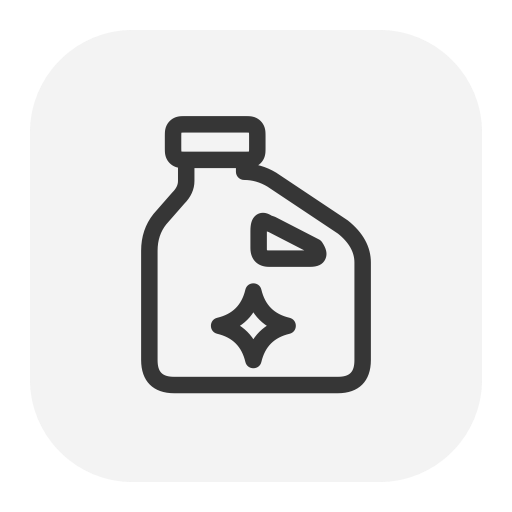

<p align="center">
  
</p>
<h1 align="center">Bleach</h1>
<p align="center">A little more room. A way back.</p>
<p align="center">
  
  
  
</p>

Bleach reviews caches, logs, installers, build artifacts, apps and duplicate files. Use the native Mac app or the `bleach` command. Both share one cleanup engine, the same exclusions and the same recovery history. Its original monochrome icon follows the local Tuck and Snap family.

## Clean up

Open Bleach and choose **Scan Your Mac**. Scanning changes nothing. Rebuildable caches start selected, including recent caches and package-manager caches. The large number shows private bytes in your selection and updates as you select or deselect items. Shared blocks appear separately. Installers, project artifacts and personal app data wait for your choice. Known running app caches are marked **In use** and stay unselected.

On first use, macOS may ask to access Downloads while looking for installers. Respond to that system dialog to let the scan continue, or cancel the scan in Bleach.

Expand a kind or switch to the item table to inspect paths, sizes and consequences. Distinct coloured SF Symbols identify each kind of storage. The segmented meter shows measured volume space; the selected private-byte total stays separate.

Choose **Light**, **Balanced** or **Thorough**, or select items yourself. Thorough includes generated output but keeps project dependencies, installers and personal data manual. **Review Cleanup…** shows the exact selection. Choose **Move to Recovery** for Undo, or **Delete Permanently…** for an irreversible deletion of those items. Existing Recovery batches stay.

The scan also finds HTTP, compiled-code and shader caches inside supported installed apps, including Chrome, Arc, Brave, Edge, Figma, Notion, Slack, Discord and T3 Code. Chromium component/extension download archives and Google update payloads are separate from installed copies. Browser sessions, cookies, service-worker storage, offline documents and app databases stay. Running apps, helpers, updater executables and visible process references keep their caches unselected.

Developer coverage includes Cargo download archives and Prisma engine downloads, plus npm/npx, pip, Gradle and Go caches moved through supported user configuration or environment variables. Configured paths are checked again before cleanup. Known uv, Bun, pnpm and Yarn cache directories are retained; these stores can supply installed environments directly. Unsupported layouts and inaccessible app caches stay in place.

Recovery keeps files on disk. Restore a batch to put its files back, or choose **Delete Permanently…** to remove them. Blocks shared with another file or snapshot may remain. Bleach never empties your Mac’s Trash. A recreated original path is kept alongside the recovery copy until you resolve the conflict.

## Menu bar and quick actions

The bottle in the menu bar opens a compact disk and resource panel. Scan, choose kinds, review exact items and move or permanently delete them there. Undo is available in the panel. The main window and menu bar share the same selection and history. **⇧⌘M** also opens these controls in a native panel, including on desktops without a usable menu-bar anchor.

Press **⌘K** to find actions, quit an app, review an uninstall, or copy a cleanup report for your agent. Force Quit has a separate warning about unsaved changes. **System** groups apps with their visible helper processes and ranks them by memory footprint or CPU. The GPU reading and driver memory counters are whole-device and remain unavailable when the driver provides none; per-app GPU percentages are unavailable. Bleach never quits apps automatically or claims to purge memory.

## Automatic cleanup

Auto mode starts **off**. Enable it in Settings only after accepting permanent deletion, then choose a free-space threshold in GB or percent. While Bleach is open, it checks once a minute and clears at most 32 eligible items / 8 GB per pass: unused raw npm/Cargo archives, pip HTTP downloads and logs unchanged for at least 90 days. You can pause it for an hour or disable either kind.

Generic app/browser caches, compiler/build output, installed dependencies, installers, source, Git, chat history and existing Recovery batches are excluded. In-use, excluded, shared, hard-linked and unverified files stay. Downloads may need an internet connection again. Automatic passes use a narrow scan without walking your project folders; they do not promise to reach a threshold when no eligible files remain.

## Connect an agent

`bleach mcp` starts a local read-only MCP server. Settings can copy a Claude configuration or Codex setup command. Optional flags expose exact-preview Recovery actions and, separately, permanent deletion. See [MCP setup, tools and approval boundaries](docs/MCP.md).

## Find more space

Choose **Find More Space → Generated Outputs & Archives** after a scan, or press **⇧⌘F**. It adds evidence-backed items to the same review:

- **Project outputs:** discovers dependency/build folders beside matching manifests, Swift compiler output under custom `build/spm`, `build/tests` and `build/checks` scratch paths, and custom Next.js output identified by build markers. It also reviews Contentlayer's processing cache and Godot's imported resources beside matching project files. Swift checkouts, generated Contentlayer modules, Godot import settings, mixed media folders and packaged apps stay in place; each output needs your choice.
- **Already expanded ZIPs:** checks every supported archived file against its adjacent expanded folder with full SHA-256 and ZIP integrity checks. This finds redundant compressed copies that ordinary duplicate-file hashes miss.
- **Already-installed app installers:** matches a ZIP app installer or an already-mounted DMG to an installed app by bundle ID, version and build. A matching filename is insufficient. Different versions remain unmarked; offline backups can still be worth keeping.

These items start unchecked. The app reports their private bytes separately and keeps the large number tied to your actual selection. Installed apps, project source and expanded folders stay in place. Archive contents and installed-app identity are rechecked before a cleanup moves anything.

In the controlled coverage fixture, these methods found **220 MiB beyond the quick scan's 16 MiB**, including every expected item and none of the mismatched/unsafe/upgrade decoys. This is a constructed fixture, not a typical-Mac savings claim. See [discovery evidence, reproduction and format limits](docs/DISCOVERY.md).

## Inactive projects

Choose **Find More Space → Inactive Projects**. Bleach reviews `node_modules` and locked uv Python environments only after at least 30 days without observed source or Git activity. It checks modification, creation and metadata-change times, visible working directories, executable/argument paths and open files. A directory's age alone is insufficient. Partial activity/reference checks and unknown or conflicting reinstall recipes retain the environment.

Nothing starts selected. Each item includes its reinstall command. Source, Git, manifests and lockfiles stay; local edits inside a dependency directory do not. These checks run again before a saved plan is applied. Linked Git worktrees currently require manual activity review.

## See what grew

Open **Growth**, or choose **Track Growth** while exploring a folder in Space. Capture a baseline, work normally, then refresh to compare private allocation. **Save New Baseline** advances the reference. The first capture creates the reference; refresh alone leaves it unchanged.

Baselines contain paths, timestamps and size metadata for at most eight folders and 256 direct children per folder. Partial or oversized scans never replace a baseline. **Agent Storage** measures Codex or T3 without editing sessions, context or databases. No background watcher or file contents are stored. A private-byte change can reflect APFS sharing as well as added or removed files; volume availability is shown separately.

## Keep duplicate captures, share their storage

In **Duplicates**, select generated Playwright copies and choose **Share Storage…**. Bleach keeps both paths using independent APFS clones, so report links keep working and later writes affect only the edited copy. This first version covers ZIP, PNG and WebM captures in recognized report/artifact layouts beside a Playwright project; ordinary documents, source, hard links, cloud data and signed bundles are excluded.

Bleach stages originals in a specific Recovery batch, creates clones inside private Recovery storage, copies metadata, verifies full SHA-256 and moves them into place without overwriting. Only then does it permanently erase the verified originals from that batch. This operation has its own confirmation. If anything fails or changes, originals remain in Recovery; an existing original path is never overwritten by Undo. Interrupted temporary clones are journaled and checked before disposal. Already fully shared copies offer no private-byte saving.

To slow recurring growth, reuse project/build directories, bound command output before capture and retain failure evidence rather than every successful test recording. Playwright supports [first-retry trace capture](https://playwright.dev/docs/trace-viewer-intro).

## In the terminal

Run `bleach` for the keyboard-controlled menu. Use **↑ / ↓** or **j / k** to move, **Space** to select, **a** to select suggested items, **Return** to review and **q** to cancel.

```sh
bleach scan                              # Read-only cleanup review
bleach discover                          # Find projects, expanded ZIPs and installed-app installers
bleach discover ~/Projects --output more.json
bleach inactive ~/Projects --output old.json # Review genuinely inactive dependencies
bleach growth ~/Projects/MyApp --record  # Capture a local metadata baseline
bleach growth ~/Projects/MyApp           # Compare without advancing the baseline
bleach clean                             # Choose items and confirm a recoverable cleanup
bleach analyze ~/Downloads               # Separate private and shared disk usage
bleach duplicates ~/Documents            # Compare complete file contents
bleach duplicates ~/Projects/Web --output copies.json
bleach share copies.json --dry-run       # Preview eligible capture copies
bleach share copies.json                 # Confirm path-preserving APFS storage sharing
bleach apps                              # List installed apps
bleach uninstall /Applications/App.app -n # Preview app removal
bleach history                           # Inspect recovery batches
bleach undo                              # Restore the latest recoverable batch
bleach empty <batch>                      # Confirm permanent deletion of one batch
bleach apply plan.json --permanent        # Review and permanently delete the exact selection
bleach mcp                               # Read-only local MCP server
```

Save a preview to review or apply later:

```sh
bleach scan --output preview.json
bleach apply preview.json --dry-run
bleach apply preview.json
```

Saved plans expire after 24 hours. Bleach rechecks file identity, recursive metadata, exclusions and running owners before moving anything. A changed item requires a fresh scan. When applying a plan, choose individual paths or the IDs shown in terminal output with repeated `--select` options.

`--json` produces structured output. `--yes` confirms a requested operation in scripts; redirected input never counts as confirmation. `NO_COLOR` and `--no-color` disable color. Generate completion with `bleach completion zsh`, `bash` or `fish`.

## More ways to make room

| View | What it does |
| --- | --- |
| Space | Ranks folders and files by private disk usage, with shared allocation shown separately. Drill into a folder or reveal a file in Finder. |
| Growth | Compares private allocation with an explicitly saved local baseline. Sessions and databases stay intact. |
| Duplicates | Groups equal-length files by full SHA-256. Choose which copy to keep; review the extras before cleanup. |
| Applications | Reviews a user-owned app and exact bundle-ID matches. Personal data is a separate choice; shared app-group data stays in place. |
| Recovery | Shares cleanup batches between the CLI and app. Interrupted moves are reconciled from their journal. |
| System | Shows measured CPU/GPU, memory, swap and process footprints, with explicit quit actions. |

Add project folders in **Settings**, or use `bleach config --add-project ~/Projects`. Bleach recognizes `node_modules`, `.build`, `target` and `.next` beside matching manifests. It keeps source files. Exclude a folder with `bleach protect <path>` or the item’s context menu; the exclusion applies to both interfaces.

## APFS and references

Bleach asks macOS for each file's private allocation (`ATTR_CMNEXT_PRIVATESIZE`) rather than treating `du`-style allocation as a savings estimate. The CLI and app use the same accounting:

| Size | Meaning |
| --- | --- |
| Private | Bytes macOS reports as belonging only to that file, outside clones and snapshots. This drives the large number and Space ranking. |
| Allocated | Blocks attributed to the files. APFS clones can each report the same shared blocks, so this total can exceed physical usage. |
| Logical | File contents' length. Sparse files can have a large logical size with little allocation. |

A fully shared APFS clone can show **2 MB allocated, 0 KB private**. A partially changed clone contributes only its private extents. Shared or snapshot-retained bytes are shown separately, including when the other clone is outside the scanned folder. Bleach does not search your whole disk for the other copy.

Hard links are counted once and excluded from the private estimate. Symbolic links and Finder aliases never add their targets' contents; mounted volumes are not traversed. Unsupported or unavailable private-size metadata is labeled **unverified** and excluded from the private number. Older saved plans remain usable but their sizes are unverified until rescanned.

Private bytes are a conservative per-file measure, not an exact folder footprint or promised free-space gain. Removing every copy in a clone or hard-link group may free more. Shared-byte totals can include repeated references to the same blocks. Allocation can change after scanning, and moving files to Recovery frees no space.

## Improvements over Mole CLI

Bleach builds on the workflows researched in [Mole](https://github.com/tw93/Mole), with an original implementation:

- Recoverable cleanup batches with cross-interface undo and per-item interruption recovery.
- Exact saved previews that reject changed targets and newly excluded files.
- Full-content duplicate review with a retained copy revalidated before cleanup.
- Native tables, item explanations, keyboard commands and shared CLI/app state.
- APFS private/shared accounting across cleanup, duplicate review and folder analysis.
- Activity-aware inactive dependency review with locked reinstall recipes and apply-time rechecks.
- Custom compiler-output discovery, local growth comparisons and path-preserving storage sharing for generated captures.
- Read-only analysis [timings, source revision, method and limits](docs/benchmarks/results.md) are recorded with raw results. Those earlier allocation-only timings do not measure the added APFS metadata queries.

Mole has a broader catalog of vendor-specific recipes and system maintenance. Bleach does not alter system services, strip signed apps, purge memory or promise a general Mac speedup. See the [research](docs/RESEARCH.md) for the comparison and sources.

## Download

Download the latest [release](https://github.com/upsidedly/bleach/releases/latest), open the `.dmg`, and drag **Bleach** into **Applications**. These builds are for Apple silicon Macs. Quit an older Bleach before replacing it.

The app is locally signed and is not notarized. macOS may require first-launch approval in **System Settings → Privacy & Security**.

The bundled CLI is at `/Applications/Bleach.app/Contents/MacOS/bleach`.

## Install from source

Use macOS 14 or later with Swift 6 and the macOS SDK. From this folder:

```sh
./scripts/install.sh
open /Applications/Bleach.app
~/.local/bin/bleach
```

Add `~/.local/bin` to your `PATH` to use `bleach` directly. Quit Bleach before updating. The installer signs locally and backs up an earlier app or unrelated CLI.

For a build without installation, run `./scripts/build.sh`. The outputs are `build/Bleach.app` and `build/bleach`.

## Privacy and limits

Bleach uses no network, account, telemetry or privileged helper. Optional Auto cleanup runs while Bleach remains open and starts disabled. Cleanup stays within recognized user-owned locations. Credentials, browser profiles, photo libraries, Codex/T3 session stores, known cloud roots and shared application groups are outside automatic cleanup. Process arguments are inspected only for path references and are never stored or logged. Unreadable targets are skipped with a reason. Grant Full Disk Access in System Settings only if you want to inspect additional protected locations.

Recovery uses same-volume moves; cross-volume cleanup is refused. Available space may differ from allocated bytes because APFS clones, snapshots, hard links and other apps can share or change disk allocation. A running owner can start after its last check; the recovery journal reduces consequences but does not lock third-party applications.

## Development

Run `./scripts/test.sh` for core tests and `./scripts/check.sh` for tests plus CLI integration checks. The test script supports the installed Command Line Tools Testing framework without changing the global Xcode selection.

See [development notes](docs/DEVELOPMENT.md), [verification](docs/VERIFICATION.md) and the [benchmark](docs/benchmarks/results.md).

ZIP reading uses exact-pinned ZIPFoundation 0.9.20; [its MIT notice](docs/THIRD-PARTY-NOTICES.md) is included in the app and `bleach --licenses`. No archive is extracted or installer launched during discovery.
